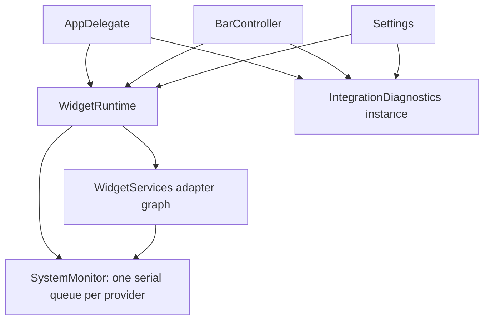

# Architecture

`AppDelegate` is the composition root: it constructs one `WidgetRuntime` with a `WidgetServices` adapter graph and one `IntegrationDiagnostics`, then passes those instances to `BarController` and `StatusMenuController`/settings. `StatusMenuController` owns menu actions; `BarController` owns live state and scheduling. All configuration changes and rendering happen on the main queue. Immutable snapshots are passed to workspace and system-sampling queues. Slow system providers do not block workspace interaction. In-flight refresh requests are coalesced.

## Source ownership

`App/` owns startup and composition. `Core/Configuration/` owns persistence; `Core/Widgets/` owns shared registry and sampling contracts. `Shell/` owns windows, layout, workspaces and overlays. `DesignSystem/` owns reusable AppKit styling. `Settings/` separates each settings section from the window coordinator. `Widgets/<Feature>/` keeps each provider, domain model and panel implementation together.

`MiniAppPanel` owns shared chrome, the bounded scroll viewport, pinned action feedback, action routing, refresh and dismissal. Music's `MediaPanelContent` owns source/tab selection and its structural signature. `CalendarPanelContent` owns browsing day, chooser visibility and event selection; it reconciles selection against each visible event collection and bounds navigation to the sampled date range. `TimerPanelContent` binds explicit ready/running/paused/finished provider phases and keeps its primary actions ahead of presets. `SystemPanelContent` owns typed tab, history-range and process-sort state; Memory starts on its own tab, and CPU sorting exposes the same direction in its label and accessibility value. `KeepAwakePanelContent` owns the next-session display choice, while active-session state comes from the provider. These content objects live in their feature folders and hold weak references to the host. Audio/VPN and other rich panels still extend the shell and share its broader state. Shared UI helpers are internal because feature content uses them across files. These folders are ownership boundaries within one executable target, not separately loadable binaries.

The shell recalculates compact content when its body viewport drops below 300 points, including a height-only resize, and rebuilds through the same focus-restoration path. Compact stacks use tighter spacing. Music bounds metadata and artwork, places transport before progress/detail, and preserves source/tab selection. Calendar combines date/navigation and keeps its week controls followed by the agenda; permission actions precede long explanations. Full content remains in the scroll document. Native tests distinguish initial primary-control visibility, later scrolling reachability, and logical focus/selection across resizes. They do not establish active-app keyboard or VoiceOver behavior.

Action failures stay in a single-line pinned footer with full native text/tooltips and an explicit Details action, so long messages cannot displace the feature's controls. `DesignSystem/ErrorDetailsPresenter` supplies the same bounded, selectable, scrollable sheet for action and settings-save failures; it does not queue a second sheet. Opening Details is a user action. `BarOverlayCoordinator` consumes plain Escape only for its visible pinned panel when no sheet is attached; other windows, modified Escape and sheet interactions keep their events. Native synthetic events through `NSApp.sendEvent` verify that local-monitor boundary; they do not establish hardware keyboard or active-app routing. [Apple documents local monitor dispatch and cancellation](https://developer.apple.com/documentation/appkit/nsevent/addlocalmonitorforevents(matching:handler:)).

For a backend contributor, the closest equivalents are:

| Responsibility | Entry point | Boundary |
| --- | --- | --- |
| Application service / orchestration | `App/BarController.swift`, `Core/Widgets/WidgetRuntime.swift` | Applies saved snapshots, schedules refreshes, and routes commands to the sampled adapters. |
| Settings transaction | `Settings/ConfigurationEditingSession.swift` | Validates a candidate, calls injected persistence, and advances the saved baseline/Undo only on success. |
| Reminders settings discovery | `Settings/ReminderListSettingsView.swift`, `WidgetRuntime.readReminderLists` | A feature-owned view reconciles list/control identity and selection from a list-only snapshot; the runtime reads through the same adapter and queue as sampling. |
| Configuration repository | `Core/Configuration/ConfigurationRepository.swift`, `ConfigurationStore.swift` | An injected repository owns loading/error state, destination protection, backup and atomic writes. The application facade resolves paths, posts notifications and presents alerts. |
| Domain configuration / wire DTO | `BarConfig` / `ConfigFile` in `Configuration.swift` | Configuration invariants and migrations versus the persisted JSON shape. |
| Integration port / adapter | `SystemProviding`, `WorkspaceProviding`, `RemindersReading` / concrete readers | Feature logic consumes snapshots; OS/process access stays in adapters. |
| View / shell | Feature panels and `Shell/` | Renders state and routes actions; avoids owning persistence and provider work. |

Start a settings-rule change in the session and its tests; start a provider change in its feature folder and reader protocol. AppKit constraints and window behavior belong to the shell or settings views. Provider composition is explicit in `WidgetServices`; current folders do not enforce package-level access boundaries.



There is no `WidgetServices.shared` or mutable global integration snapshot. Tests and previews construct isolated graphs; production passes startup's graph explicitly. `SystemMonitor`, `MediaProvider` and `CalendarProvider` require their dependencies. Runtime actions use the same adapter instances as sampling. Explicit settings permission requests can operate while the widget is hidden, but they still enter that provider's serial queue. Ordinary widget actions require an active generation. Permission callbacks return on the main queue and complete only once, after the permission result rather than after dispatch.

Diagnostics publishes from the main queue and scopes changed/refresh notifications to its own instance. Configuration-file status has a separate repository notification; a file save does not masquerade as a new provider sample. The application retains its canonical configuration-store and updater status separately.

`Core/Displays/FullscreenSnapshot` keeps requested, covered and unavailable display IDs distinct. `FullscreenDetector` owns the runtime-resolved private SkyLight adapter; unsupported Space types and failed queries stay unknown. `ScreenBarController` receives an injectable reader, samples only active displays with fullscreen hiding enabled, and uses that same snapshot for visibility and instance diagnostics. Unknown displays keep their bars visible and report attention. Repeated unchanged results do not publish notifications. Settings treats a changed display scope as waiting until a matching result arrives; its report and visible row use the same entry.

The opt-in `--startup-smoke-test --keyboard-smoke-test` journey requests activation and returns to AppKit's outer event loop, then checks active/key/main state against a bounded monotonic deadline. Only a ready window exercises fixture text editing and the production menu's responder chain. Timeout remains a failing exit with state/session diagnostics; it never becomes a successful startup or skipped keyboard qualification. The session-lock indicator is diagnostic context, not proof that application activation or keyboard editing works. Native tests separately cover a real settings field's text Undo/Redo without requiring active-app routing.

## Providers

`WorkspaceProviding` exposes snapshots, workspace selection, and window focus. `AeroSpaceClient` is the first adapter. `StandaloneWorkspaceProvider` exposes active-app identity without inventing native Space IDs or requiring Accessibility permission.

AeroSpace queries reject failed, timed-out and truncated output. A snapshot reports which detail queries were unavailable; the controller retains those previously confirmed fields while showing a warning. Successful empty results clear old data. Automatic mode falls back to Standalone only when the workspace source itself is unavailable. Workspace actions throw errors that remain visible in diagnostics and the active-app tooltip until the next successful action or configuration change.

`SystemProviding` declares the widget kinds it supplies and samples into `SystemState`. `WidgetServices` composes providers and their adapters; `SystemMonitor` receives that inventory and skips providers whose widgets are disabled. Battery, metrics, VPN, media, and weather each live in separate files. `BatteryProvider.swift` is the smallest starting point for a contributor.

Calendar filters use the injected `CalendarSelectionStoring` port. `WidgetServices` passes the same store to commands and `CalendarProvider`; snapshots carry hidden calendar IDs to both compact presentation and panel content. `LocalCalendarSelectionStore` preserves the existing per-Mac UserDefaults key. Views do not read or write that key. These account-specific IDs are intentionally outside portable JSON and configuration Undo.

`CommandRunning` allows command providers to use fixtures in tests. `CommandRunner` drains stdout/stderr concurrently, bounds captured output, and terminates timed-out processes. No shell is inserted around user-configured executable paths.

`MetricsProvider` consumes `MetricsReading`; `HostMetricsReader` owns Mach, filesystem and process access. Providers own baselines and sampling cadence. CPU and network failures clear their baseline; decreasing/reset counters establish a new one before subtraction. `ReadingStatus` distinguishes available, waiting and failed measurements across CPU, memory, network and disk. Process-list status and unknown thermal pressure also remain explicit. Failures reach compact labels, panels and diagnostics without displaying invented zeros. Only valid readings enter each metric's history, with matching timestamps; `metricsSampledAt` prevents another provider's publication from adding a duplicate sample. Network interface names arrive in the sampled data rather than triggering OS reads from presentation code.

CPU/network baselines also reset when those readings are hidden while another metric keeps the provider active. A changed interface set establishes a new network baseline. Network elapsed time uses a monotonic clock; disk capacity and process output validate before numeric conversion. Simple inspectors wrap status messages and reserve their required row heights before attachment, including when a new failure increases the row height.

`AudioProvider` consumes the injected `CoreAudioAccessing` port. `CoreAudioAccess` is the only owner of raw Core Audio buffers, sizes, CFObject ownership and OSStatus checks. Inventory failure, failed default-device reads, valid empty inventories and partial per-device property failures remain distinct. Unreadable volume/mute stay unknown, and control capabilities are disabled when their current values cannot be read. Commands re-read inventory/capability before writing; a partial stereo write reports that some channels may already have changed. The adapter supports master controls and mono/stereo channel fallback; multichannel devices without a master use hardware controls. Retry asks `WidgetRuntime` to sample only the affected provider, coalesces with in-flight work and rejects hidden widgets. The controller does not trigger a duplicate general refresh for these requests.

VPN reads return typed `VPNReadResult` availability separately from their display message. The macOS adapter rejects failed, timed-out and truncated output before parsing. A successful empty listing means no services, while failed reads remain unavailable. `WidgetServices` injects the same `VPNProvider` used for sampling and control; command preflight validates a fresh listing on its provider queue. Hiding the last Agent Status display reaches provider deactivation, invalidating the remote monitor generation and cancelling queued SSH probes. An already-running bounded command may finish, but its result cannot enter the new generation.

## Widgets

`WidgetCatalog` supplies each widget's compact presentation, inspector rows, and overflow priority. `WidgetModule` is the view-independent descriptor; `ModernWidgetView` in `Shell/Widgets/ModernWidgetView.swift` receives only an icon, label, accent, and optional history.

To add a built-in widget:

1. Add its identifier, title, and SF Symbol to `WidgetKind` in `Configuration.swift`.
2. Add its state to `SystemState`, if needed.
3. Implement `SystemProviding` in a new file and register its instance in `WidgetServices`.
4. Register its presentation, inspector rows, and priority in `WidgetCatalog`.
5. Add provider/parsing fixtures. The settings picker and rendering reuse the registry automatically.

The registry currently uses a closed set of built-in identifiers. It is intentionally a compiled Swift extension point. A versioned external script protocol, plugin permissions, per-module refresh intervals, and plugin installation are not yet implemented. They can be added without changing the AppKit layout contract.

## Layout and configuration

`LayoutGeometry` is deterministic geometry shared by the running bar and preview. Workspace overflow keeps long sets accessible, and widget overflow collapses low-priority modules. Workspace/window pickers share `WindowCollectionPanel`, which owns bounded viewport sizing, a scrollable document and keyboard reveal; feature views supply cards or rows without truncating the collection. `ScreenBarController` applies display overrides and workspace ownership before rendering. Closing or hiding a bar dismisses its floating panels; coordinator teardown cancels queued work and removes keyboard monitors.

`WindowPlacement` limits floating-window size and position to the available screen frame. The overlay coordinator applies it on show and refresh. Rich panel content reflows to the available width, uses a shared scrolling body, and keeps close/pin controls outside that body. Calendar stacks its columns in narrow viewports. `SettingsWindowLayoutView` owns wide/compact navigation constraints; widths below 860 points or heights below 560 use a section picker and full-width form. Short windows hide duplicate headings and the live preview while preserving the selected-display control. `SettingsRecoveryView` keeps save state, Undo and recovery actions outside scrolling documents. Complete errors use bounded native selectable text. At the supported 640-point minimum, every settings page fits the form width; narrower physical frames retain horizontal scrolling as a fallback. Native resize/focus/geometry tests cover these contracts, without qualifying physical displays.

`DisplaySettingsEditor` reconciles `WidgetArrangementRow` objects by `BarItem` identity. Rows own their native controls and typed callbacks; order/zone changes update the same objects rather than recreating them. A disabled reorder action falls back to that widget's zone picker; hiding the widget returns focus to Add widget. Undo can restore the cached row. Resize moves navigation focus to its visible equivalent, and visible labels are associated with display controls. These are native focus/accessibility-property assertions, not hardware-keyboard or VoiceOver qualification.

`MetricPlot` exposes a metric-specific accessible name and a recorded-history summary with count, latest, minimum, maximum, units and selected time window. An unavailable current measurement stays separate from recorded values. Invalid/nonfinite samples are excluded from both summary and drawing. Network summaries use checked conversion to the byte formatter. AppKit's value/value-description API supplies the summary; this does not establish a complete VoiceOver chart journey or an interactive accessible data table.

`DisplayScope` resolves connected display IDs, primary-display selection, enabled overrides and effective widget layouts without importing AppKit. Rendering, sampling and diagnostics use that same scope. Saved disconnected overrides and unused global widget layouts do not activate providers. Display changes immediately refresh sampling with a new generation when the scope changes, rejecting old results and deactivating providers that lose their last target display. Temporary fullscreen hiding does not change ownership.

`BarConfig` validates and migrates data. `ConfigFile` is the Codable wire format. `ConfigurationStore` owns canonical path policy and delegates protected backup/atomic saves to `ConfigurationRepository`. Old configurations preserve their composition and settings; defaults apply only where settings are absent.

`ConfigurationEditingSession` owns the mutable draft, saved baseline, raw form input, validation, persistence result and bounded Undo history. Its persistence closure is injected; it returns a configuration to apply only after a successful write. `ConfigurationWindowController` routes control actions to the session and renders the resulting state. Session tests run without constructing windows. This follows the same snapshot/adapter separation as providers rather than adding a generic inheritance framework.

`ConfigurationRepository` is Foundation-only and receives active/writable path resolvers. Tests construct independent repositories over temporary files. A missing default source clears a previous load error; Retry revalidates a failed source before deciding whether writing is still blocked. Explicit read failures remain errors, and existing malformed destinations are never silently replaced. `ConfigurationStore` preserves the application-facing static facade for canonical path policy, notifications and alerts; the repository does not depend on that facade or AppKit.

`PanelFocus` captures a body control's stable identifier and text-selection range before a structural rebuild, then restores the corresponding enabled control. Removed controls receive a nearby usable fallback. Header focus stays outside this process, and restoration never activates a window. Shared panel helpers assign identifiers; controls whose labels change or whose names can duplicate use feature IDs, such as `timer.primary`, calendar event IDs and audio device IDs. Give new stateful controls stable IDs rather than depending on changing display text.

`ApplicationMenu` builds the main menu installed by `AppDelegate`, including standard Edit commands with responder-chain targets. Key-equivalent tests use native events and isolated targets; automatic dispatch through an active application is a separate smoke journey under `App/Verification/`.

Weather, Timer and World Clock input keep raw text separate from validated preferences. Invalid text survives page/display changes, retries and unrelated edits until corrected or reverted. A complete candidate validates before any form values replace the draft or reach persistence. An external reload establishes a new saved baseline and clears obsolete Undo history; if a failed form is open it remains editable, and Revert returns to the newly loaded baseline. Explicit imports replace pending raw input. Application controls update their own settings, and the refresh picker retains exact imported intervals through a custom entry.

Reminders separates Foundation-only models, the EventKit reader and provider cache/lifecycle. `ReminderDeadline` preserves source components and precision. Date-only comparison uses the next calendar-day boundary; presentation never uses that comparison boundary as a fabricated due time. Floating dates resolve in the current time zone, while explicit zones remain fixed. Authorization is checked independently of read success. Transient read failures preserve a marked, bounded cache; list changes, revocation and deactivation clear prior data. Retry uses the same provider queue as sampling rather than requesting permission again.

Reminders settings consumes `ReminderListSnapshot` through `WidgetRuntime.readReminderLists` and `SystemMonitor.readSetup`. List-only discovery can run while the widget is hidden, never fetches task contents or requests permission, and is serialized behind sampling/actions. Stop rejects queued and in-flight results. `AppleRemindersReader` translates its own EventKit store-change notification into an invalidation; the runtime scopes notifications to its instance, invalidates the task cache on the provider queue and requests a new sample only if active. Stopping cancels observation. Permission completion, store changes, presenting settings and app reactivation refresh list choices.

`ReminderListSettingsView` owns discovery presentation and coalesces invalidations during a read into one follow-up, discarding the superseded result. It reconciles controls by list ID, retaining renamed/focused controls and preserving the current configuration selection without saving. Missing selected IDs remain explicit, removable “Unavailable selected list” choices, avoiding an automatic switch to all lists. Revocation/failure removes private list names; Refresh lists provides a read-only retry. These behaviors are covered through injected readers and native settings/control journeys. Real consent and account synchronization still require live qualification.

`BarController` owns a one-second local presentation timer only while the display scope contains Timer, Keep Awake, Clock or Reminders. `WidgetRuntime.refreshLocalTime` requests only active Timer/Keep Awake samples through their existing serial queues, preserving command order and generation rejection. Clock/overdue presentation renders from the current wall date; external provider polling retains its configured cadence. The local timer is removed when its last widget leaves the scope and on stop. Countdown labels round positive fractions upward; media elapsed-time formatting is unchanged. Keep Awake mode changes create a replacement assertion before releasing the old one and retain the original continuous-clock deadline.

Native view previews:

```sh
swift run ConstellationBar --render-previews .build/previews
```

This renders real AppKit views at wide and constrained widths without changing the running configuration. It requires a macOS graphical session. Geometry/parsing tests run independently.


Appearance.swift defines the complete visual languages independently of BarLayout. BarConfig resolves a theme from appearance and native light/dark mode; no mutable palette snapshot overrides the selected style. ModernControlView owns shared surfaces, native glass availability, accessibility material fallbacks, and corner geometry. OverlayContentView uses that renderer too. The collapsed workspace selector uses `WidgetActionButton`, so text follows the selected theme even when the host window uses the opposite appearance. Legacy indicator keys are ignored on import and omitted by the current schema. AppearanceChoiceButton is a native keyboard-accessible swatch; the main settings preview renders actual BarRootView instances.

`BarTheme.textAccent` resolves dynamic status colors in the selected theme appearance, then adjusts colored text against that theme's opaque background. The regression criterion is at least 4.5:1, following [W3C's normal-text contrast guidance](https://www.w3.org/WAI/WCAG22/Understanding/contrast-minimum.html). Palette colors used for graphs and glyphs remain separate. This numerical check does not qualify live glass backdrops, antialiasing, or the complete application's accessibility.

### Agent status adapters

`AgentStatusProvider` samples enabled `AgentStatusIntegrating` implementations. Each returns an `AgentProviderSnapshot` with a stable ID, availability and active/idle/unknown task states. Codex is the initial adapter; it validates live writer locks and reads versioned local lifecycle metadata without spawning a server. Other agent adapters reuse the count, detail panel and provider toggles. `WidgetPresentation.compactText` lets widgets retain essential numeric status when the layout switches to Compact.

`WidgetKind.selectableCases` defines the current picker/menu catalog. The legacy CPU and memory identifiers stay decodable and normalize to one System entry on import, preserving placement in global and display-specific lists.
