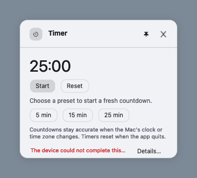
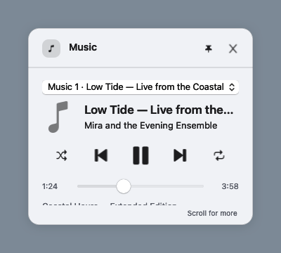
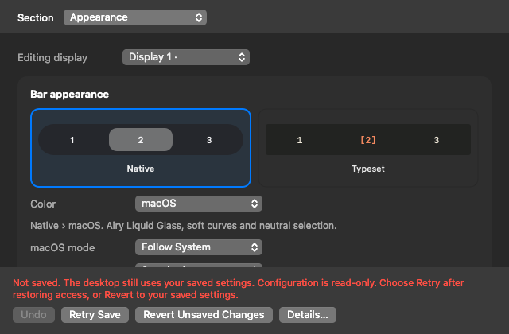

# ConstellationBar 0.8.2 Beta

This candidate improves reliability, panel consistency and settings recovery. It preserves existing configuration and does not add permission requests during background sampling.

## Changes

- Failed settings saves keep the saved configuration active and offer Retry, Revert and complete error details. Undo and partially edited fields retain their intended state.
- Provider failures report unavailable or explicitly saved data, rather than plausible zero readings. Reminders list choices preserve unavailable selections and clear private data after permission revocation.
- Music and Calendar prioritize their main controls in short windows and preserve selections and focus across resizing. Shared controls size correctly across appearances.
- Timer distinguishes Ready, Running, Paused and Finished, with matching Start, Pause, Resume and Start again actions. Long action errors stay in a pinned footer; Escape only dismisses its owning pinned panel.
- CPU and memory reads release their Mach host-port references, correcting a resource leak in recurring sampling.
- Feature-owned content, explicit runtime dependencies and injected OS/persistence readers make behavior easier to follow and test.

## Validation and release status

The candidate passes **352 native tests**, including actual executable startup, and **13 Python checks**. Fresh app/helper compilation has zero warnings (XCTest compilation excluded). Native export produces 190 PNGs. Two new native regressions reproduce one retained host-port reference per CPU/memory read before the correction and zero growth across 1,024 reads of each afterward. See [checkpoint I15](../quality/I15.md) for final package evidence and the independent assessment.

Local packages use ad-hoc signing. Before distributing this version, run the existing signed-release workflow, require Developer ID signing, accepted notarization, stapling and Gatekeeper verification, and retain its evidence. Creating or merging the preparation PR does not publish a release.

An unlocked-session keyboard and VoiceOver pass, real account/device and physical multi-display journeys, Intel/minimum-OS execution, long-running energy measurements and signed update/rollback qualification remain outstanding. The current host's locked session cannot exercise the active keyboard journey. Private SkyLight/MediaRemote compatibility is not established across every supported OS version. Timer completion is visual only; no sound or notification is sent.

## Install after publication

Use the verified `ConstellationBar-0.8.2-universal.zip` and matching `SHA256SUMS` from the published release. Verify the checksum before extracting and moving the app to Applications. Do not substitute the CI development artifact for the signed/notarized distribution archive.

## Representative native captures

These constructed opaque captures show the candidate's authored layout; they do not qualify live materials or hardware input.

